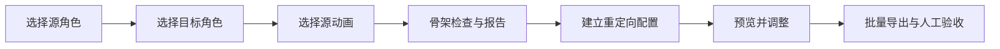

# RetargetAssistant · 动画重定向助手

**面向 Unreal Engine 5.8 的人形角色动画重定向编辑器插件。**

把骨架检查、IK Rig / IK Retargeter 配置、批量动画导出、持枪 IK 校准和 Control Rig 生成放到一个可重复使用的流程中，帮助开发者理解重定向问题，并将具体证据交给 AI 辅助分析。

An Unreal Engine 5.8 editor plugin for humanoid retargeting, weapon-contact IK diagnostics, reversible calibration copies, two-arm Control Rig authoring, and AI-readable reports. Python-based, with a Chinese editor menu. No bundled models or animation assets.


## 适合谁

正在学习 UE 动画流程，或者需要把多组人形角色与动画接入项目的开发者。你仍然需要在预览中判断动作质量；助手负责组织流程、检查结构和记录可供分析的证据。

## 当前功能

| 功能 | 当前行为 |
| --- | --- |
| 骨架检查 | 检查根节点、层级、关键骨骼、左右肢体和命名歧义；识别 UE Mannequin 与常见 Mixamo 命名 |
| 重定向配置 | 建立新的源 / 目标 IK Rig 和 IK Retargeter，检查必要链映射；可用时尝试自动定义与姿势对齐 |
| 批量导出 | 转换所选 Animation Sequence，校验源骨架绑定、输出骨架、轨道、帧和采样姿势 |
| 持枪 IK 检查 | 检查实际角色 / 武器 / Anim Class、Socket 归属、双臂可达范围、节点权重与可追踪的旋转空间 |
| IK 参数校准 | 导出可编辑配置，在新的动画蓝图副本上调整既有常量参数，支持冲突检测与局部恢复 |
| AimOffset 检查 | 对照零坐标中心样本与加法参考动画，记录身份差异及证据范围 |
| Control Rig | 为目标骨架生成双手目标、肘部控制器、独立权重与实际双臂 IK 求解图 |
| 诊断报告 | 输出 Markdown 与 JSON，注明已检查项目和仍需人工验证的部分 |
| 编辑器入口 | 内容浏览器选择资源后，通过 **Tools → 动画重定向助手** 操作 |
| 工程边界 | 仅在明确配置的工程启用；生成资源使用独立目录，禁止覆盖已有动画 |

**AI 协作方式：**把生成的报告及预览截图交给你使用的 AI 助手，获取解释和调整建议。插件本身没有聊天窗口、模型调用、API Key 配置或自动上传功能。

## 环境要求

- Windows 与 Unreal Engine **5.8**；本地编辑器验证版本为 **5.8.3**。
- UE 插件：Python Editor Script Plugin、Editor Scripting Utilities、IK Rig、Control Rig。插件描述文件已声明依赖。
- 运行下面的工程配置脚本，需要 Python **3.10+**。也可以按下方说明手动创建配置。
- 角色和动画由使用者自行提供。本仓库不包含 Unreal Engine、示例工程或第三方素材。

其他 UE 版本尚未验证；创建配置和导出操作会拒绝非 5.8 版本。

## 安装

建议先在独立测试工程中使用自己的资源副本，验证结果后再用于正式项目。

1. 下载本仓库 ZIP，或克隆仓库。
2. 将仓库目录命名为 `RetargetAssistant`，放入目标工程的 `Plugins` 目录。确认结构为：

   ```text
   MyProject/
   ├─ MyProject.uproject
   └─ Plugins/
      └─ RetargetAssistant/
         ├─ RetargetAssistant.uplugin
         └─ Content/Python/...
   ```

3. 在编辑器关闭时，在插件目录执行以下命令，把示例路径换成你的 `.uproject` 完整路径：

   ```powershell
   python tools/configure_project.py "D:/YourProject/MyProject.uproject"
   ```

   这一步只创建 `Config/RetargetAssistantProject.json`，将助手绑定到这个工程。它不会改写 `.uproject`、角色或动画。如果已有不一致的配置，脚本会停止。

   没有独立 Python 环境时，可手动创建该 JSON 文件，内容如下。请填入实际工程绝对路径，Windows 路径可使用 `/`：

   ```json
   {
     "allow_generated_assets": true,
     "project_file": "D:/YourProject/MyProject.uproject"
   }
   ```

4. 打开工程，在 **Edit → Plugins** 中搜索并启用 **动画重定向助手**，接受所需依赖并重启编辑器。
5. 在 **Tools → 动画重定向助手** 找到入口。本插件没有自定义 C++ 模块。

工程被移动或改名后，需要核对并更新绑定配置。复制其他工程的授权文件不会自动适用于新路径。

## 第一次使用



1. 在内容浏览器只选一个 **Skeletal Mesh**，使用菜单将其设为源角色。
2. 选另一个 Skeletal Mesh，设为目标角色。
3. 选择属于源角色骨架的 **Animation Sequence**，通过菜单记录选择。
4. 运行“检查并生成 AI 报告”，先解决报告中的阻塞问题。
5. 建立重定向配置，再打开生成的 IK Retargeter 预览。
6. 检查手臂姿势、角色比例、脚接触与 Root Motion，按需调整新生成的配置。
7. 通过菜单导出动画，确认提示后开始转换，再逐段预览结果。

每次建立配置会生成独立的 `/Game/RetargetAssistant/Runs/<运行编号>/` 目录。报告和会话记录位于当前工程的 `Saved/RetargetAssistant/`。

## 持枪 IK 与 Control Rig（0.3）

通过同一菜单的新分组操作：

1. 选择实际使用的 Anim Blueprint，检查 IK 节点、空间、权重，以及无效的 Ignore 平移。
2. 选择场景角色和武器，或启动 PIE 后采样玩家，核对实际资源类、握点组件和双臂可达范围。
3. 导出 IK 配置，填写目标参数，生成校准副本；先预览，再决定是否用于角色。
4. 选定目标 Skeletal Mesh，生成并打开具有真实求解图的双臂 Control Rig，操作双手目标、肘部和独立权重。

完整说明、参数配置格式、空间转换与局部恢复见 [IK 与 Control Rig 使用说明](docs/IK_AND_CONTROL_RIG.md)。新 Rig 默认目标来自参考姿势，不会自动成为正确的游戏持枪目标；接入动画蓝图时需要明确由哪套 IK 负责同一条手臂。

## 资源与隐私边界

- 插件生成的资源位于上述固定目录，不主动修改源角色、源动画、Socket、动画蓝图、默认角色或玩法代码。
- 生成操作仍会向当前工程写入新资源；请保留自己的版本管理与备份习惯。
- 报告包含本机工程路径、资源名、骨骼层级等信息。对外分享前应检查这些内容。
- 批量导出关闭覆盖与引用资源递归转换。若目标目录通过链接指向工程外部，路径检查会拒绝写入。
- 卸载时关闭编辑器、禁用插件，再移除插件目录和绑定 JSON；生成动画与报告需自行决定是否保留。

## 验证状态与限制

- 仓库标准库自动化测试共 **72 项**：原骨架与工程边界 44 项、IK 诊断和校准输入 22 项、工程配置脚本 6 项。
- 0.3 的本地 UE 5.8.3 验证包括 55 项新功能检查、405 项重定向检查、401 项跨进程动画重载检查，以及原生菜单与实际安装加载检查；范围见 [0.3 验证记录](docs/VALIDATION_0_3_0.md)。这些引擎检查不属于 GitHub CI。
- 曾在本地 UE 5.8.3 独立验证工程中完成样例动画转换与重新加载检查。
- 自动化单元测试不启动 UE；仓库 CI 通过也不代表编辑器、PIE 或游戏表现已通过验收。
- Mixamo 命名识别已做核心测试，尚未覆盖各种 Mixamo 角色的端到端转换。
- 重定向流程处理人形骨架与 Animation Sequence；整套动画蓝图、Blend Space 或 Montage 迁移、非人形角色与运行时重定向不在当前流程中。0.3 可诊断已有动画蓝图及 AimOffset，并在新副本上校准已有 IK 参数。
- 轨道和姿势采样检查无法替代视觉检查。脚滑、穿模、握枪、Root Motion 和游戏内网络表现仍需人工验证。

## 开发与反馈

```powershell
python -m unittest discover -s tests -v
```

核心测试只需 Python 标准库，无需安装 Unreal Engine。架构和故障排查见 [开发说明](docs/DEVELOPMENT.md)，版本变化见 [CHANGELOG](CHANGELOG.md)。

提交 Issue 时请附上 UE 版本、插件版本、复现步骤和脱敏报告；截图可帮助判断姿势问题。请勿提交无权公开的角色、动画或完整工程。

本项目为独立工具，与 Epic Games 无隶属或背书关系；Unreal Engine 及相关资源的使用须遵守各自适用的许可。
